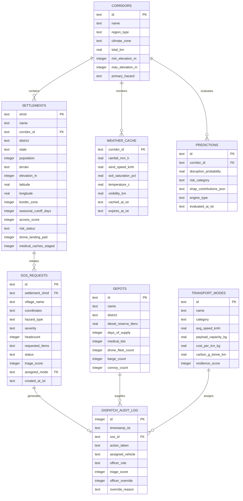

# AI-LOGIX — Database Design & Data Model (DATABASE.md)
**Project Title:** AI-Driven Multi-Modal Rural Logistics & Disaster Management Platform  
**Database Engine:** SQLite 3 (WAL Mode, zero-config, embedded, offline-ready)  
**Status:** Living Database Schema & Data Dictionary

---

## 1. Database Architecture & Storage Strategy

### 1.1 Storage Strategy
The data layer is partitioned into two functional stores:
1. **`data/shrug_keys.db` (Read-Only Socio-Spatial Assets):**
   * Pre-compiled SQLite database containing 585,179 settlement identifiers (`shrid`), parliamentary/assembly constituency keys (`ac07_name_key`, `shrid_frag_con07_key`), and spatial weights.
2. **`data/app_state.db` (Unified Application State & Audit Log):**
   * Mutable SQLite database running in WAL (Write-Ahead Logging) mode.
   * Houses canonical settlements, real-time dispatch audit logs, weather cache snapshots, SOS requests, and depot inventory.
   * If `app_state.db` does not exist on initial startup, the Node gateway automatically initializes it from pre-defined migrations and seeds.

---

## 2. Entity-Relationship Diagram (ERD)



---

## 3. Detailed Table Schemas

### 3.1 `settlements` Table (Objective 03 Single Source of Truth)
```sql
CREATE TABLE IF NOT EXISTS settlements (
  shrid TEXT PRIMARY KEY,                       -- SHRUG Settlement ID
  name TEXT NOT NULL,                           -- Village or Post Name
  corridor_id TEXT NOT NULL REFERENCES corridors(id),
  district TEXT NOT NULL,
  state TEXT NOT NULL,
  population INTEGER NOT NULL CHECK(population >= 0),
  terrain TEXT NOT NULL,                        -- e.g. 'High Alpine', 'River Delta', 'Dune Track'
  elevation_m INTEGER NOT NULL,                 -- Metres above sea level
  latitude REAL NOT NULL CHECK(latitude BETWEEN 6.0 AND 38.0),
  longitude REAL NOT NULL CHECK(longitude BETWEEN 68.0 AND 98.0),
  border_zone INTEGER NOT NULL DEFAULT 0,       -- 1 = Yes, 0 = No
  seasonal_cutoff_days INTEGER NOT NULL DEFAULT 0,
  access_score INTEGER NOT NULL CHECK(access_score BETWEEN 0 AND 100),
  risk_status TEXT NOT NULL CHECK(risk_status IN ('Low', 'Moderate', 'High', 'Critical')),
  primary_hazards TEXT,                         -- JSON array of strings
  recommended_mode TEXT NOT NULL,
  drone_landing_pad INTEGER NOT NULL DEFAULT 0,
  medical_caches_staged INTEGER NOT NULL DEFAULT 0,
  created_at TEXT DEFAULT (datetime('now', '+05:30'))
);

CREATE INDEX IF NOT EXISTS idx_settlements_corridor ON settlements(corridor_id);
CREATE INDEX IF NOT EXISTS idx_settlements_access ON settlements(access_score);
CREATE INDEX IF NOT EXISTS idx_settlements_border ON settlements(border_zone);
CREATE INDEX IF NOT EXISTS idx_settlements_name ON settlements(name COLLATE NOCASE);
```

### 3.2 `dispatch_audit_log` Table (Objective 05 Immutable Log)
```sql
CREATE TABLE IF NOT EXISTS dispatch_audit_log (
  id INTEGER PRIMARY KEY AUTOINCREMENT,
  timestamp_ist TEXT NOT NULL,                  -- 'YYYY-MM-DD HH:MM:SS IST'
  sos_id TEXT NOT NULL,                         -- Related SOS ticket
  action_taken TEXT NOT NULL,                   -- e.g. 'DISPATCH_UAV_AIRLIFT'
  assigned_vehicle TEXT NOT NULL,               -- e.g. 'UAV-7 Parachute Unit'
  officer_role TEXT NOT NULL,                   -- 'NDRF Commander', 'District DM', etc.
  triage_score INTEGER NOT NULL,                -- 0 - 100
  officer_override INTEGER NOT NULL DEFAULT 0,  -- 1 if manual override, else 0
  override_reason TEXT,                         -- Documented reason if overridden
  telemetry_hash TEXT                           -- SHA-256 integrity hash
);

CREATE INDEX IF NOT EXISTS idx_audit_timestamp ON dispatch_audit_log(timestamp_ist DESC);
CREATE INDEX IF NOT EXISTS idx_audit_sos ON dispatch_audit_log(sos_id);
```

### 3.3 `weather_cache` Table (Offline Open-Meteo Fallback)
```sql
CREATE TABLE IF NOT EXISTS weather_cache (
  corridor_id TEXT PRIMARY KEY,
  rainfall_mm_h REAL NOT NULL,
  wind_speed_kmh REAL NOT NULL,
  soil_saturation_pct REAL NOT NULL,
  temperature_c REAL NOT NULL,
  visibility_km REAL NOT NULL,
  source TEXT NOT NULL DEFAULT 'Open-Meteo',
  is_offline_cached INTEGER NOT NULL DEFAULT 0,
  cached_at_ist TEXT NOT NULL,
  expires_at_ist TEXT NOT NULL
);
```

### 3.4 `depots` Table (Operational Stock & Fuel Depletion)
```sql
CREATE TABLE IF NOT EXISTS depots (
  id TEXT PRIMARY KEY,
  name TEXT NOT NULL,
  district TEXT NOT NULL,
  diesel_reserve_liters REAL NOT NULL,
  days_of_supply INTEGER NOT NULL,
  medical_kits INTEGER NOT NULL,
  drone_fleet_count INTEGER NOT NULL,
  barge_count INTEGER NOT NULL,
  convoy_count INTEGER NOT NULL,
  last_resupply_ist TEXT NOT NULL
);
```

---

## 4. Integrity Constraints & Data Sanitization

1. **Duplicate Settlements:** When importing settlements, duplicates matching `(name, district, state)` are resolved via an `INSERT OR REPLACE` policy that retains the lowest `seasonal_cutoff_days` variance and flags a duplicate notice in the server log.
2. **Unknown SHRUG Key:** Queries for non-existent `shrid` return a graceful `{ success: false, found: false, suggestions: [...] }` payload identifying the three nearest settlements by Haversine distance, never triggering a 500 server crash.
3. **Sensor Range Validation:**
   * Rainfall must satisfy $0 \le \text{rainfall} \le 250\text{ mm/h}$.
   * Slope gradient must satisfy $0^\circ \le \text{slope} \le 90^\circ$.
   * Soil saturation must satisfy $0\% \le \text{saturation} \le 100\%$.

---

## 5. Seed Strategy & Migrations

1. **Bootstrap Script (`backend/services/seedDb.js`):**
   * Runs idempotently at gateway start.
   * Inserts canonical corridors (`corridor-himalaya`, `corridor-delta`, `corridor-desert`).
   * Loads initial 4 transport mode specifications (Road, Rail, Waterway, Cargo UAV).
   * Populates baseline depot stockpiles in Kargil, Majuli, and Longewala.
2. **Audit Log Persistence:**
   * Unlike in-memory arrays, the SQLite `dispatch_audit_log` persists across server restarts and test runs, ensuring continuous record-keeping.

---

## 6. Assumptions & Approvals

### 6.1 Assumptions
* SQLite WAL mode handles concurrent reads from Express threads without file-lock collisions.
* `shrug_keys.db` remains mounted read-only to avoid file corruption.

### 6.2 Decisions Needing Approval
* [x] **Database Schema Approved:** DATABASE.md established as data layer contract.
* [ ] **DB File Location:** Confirm creating `data/app_state.db` as the mutable counterpart to `data/shrug_keys.db`.
